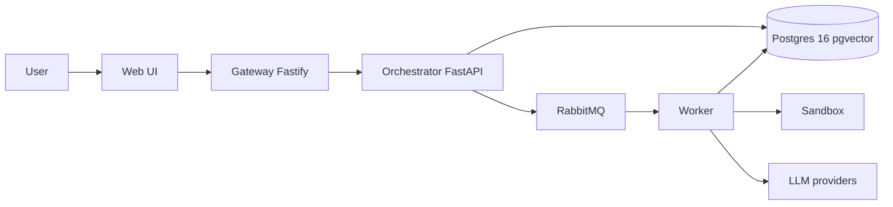

# LegacyLift

LegacyLift is a tool to migrate and test legacy code in small and verified steps. It pins current behaviour with characterization tests, applies deterministic rewrites, and marks a file verified only when those tests pass on the new runtime in an  
isolated sandbox.

## Architecture (target)



## Quick start

Requires Python 3.12, Node 20, [uv](https://docs.astral.sh/uv/), Docker,
and Make.

```bash
cp .env.example .env
make install
make test
make lint
make eval
make migrate-samples
make dev-infra
```

`make dev` builds and starts every service container (health endpoints on
gateway 3000, orchestrator 8000, worker 8001, sandbox 8002, web 5173).

| endpoint | meaning |
| --- | --- |
| `GET /health` | process is up |
| `GET /ready` | process can serve HTTP (dependency probes start in M3) |

## Results

See `docs/M1_RUNS.md` for the three Python 2 sample runs (real Docker
counts). `docs/RESULTS.md` is written by `make eval` with measured  
deterministic numbers.

## Makefile

| target | action |
| --- | --- |
| `make install` | `uv sync` and `npm ci` for gateway and web |
| `make dev` | `docker compose up --build` |
| `make dev-infra` | Postgres and RabbitMQ only |
| `make test` | pytest and vitest |
| `make lint` | ruff, eslint, prettier, mypy, tsc, bandit |
| `make typecheck` | mypy and tsc |
| `make eval` | write `docs/RESULTS.md` from corpus sandbox runs |
| `make migrate-samples` | run the pipeline on three py2 corpus trees |
| `make db-migrate` | apply Alembic migrations to DATABASE_URL |
| `make ci` | lint, test, eval |
